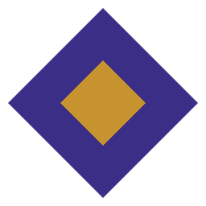
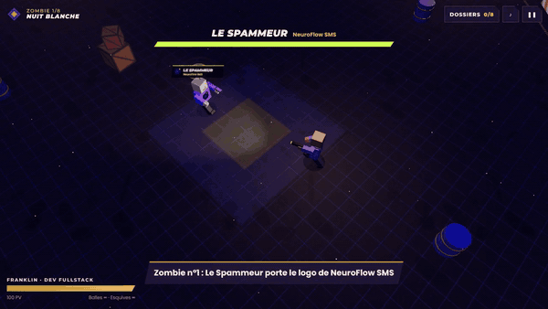

<div align="center">



# Nuit Blanche

**Le portfolio jouable de Soft Solution, studio digital basé à Douala.**

Sept projets réels reviennent la nuit sous forme de zombies, du plus faible au plus fort.<br>
Abats-les un par un : chaque zombie tombé ouvre le dossier complet du projet qu'il porte sur la poitrine.

### [▶ Jouer en ligne](https://soft-solution-portfolio.vercel.app)



</div>

---

## Les 7 zombies

| # | Zombie | Projet | Ce que c'est | Stack |
|---|---|---|---|---|
| 1 | Le Spammeur | **NeuroFlow SMS** | Campagnes de SMS envoyés depuis le téléphone de l'expéditeur, avec rapport et analyse IA | React Native, Electron, Node.js, SQLite |
| 2 | Le Coiffeur | **Soft Hair** | File d'attente en direct et prise de ticket à distance dans les salons de coiffure | React Native, Expo, Node.js, PostgreSQL |
| 3 | La Chimiste | **LabCosmetic** | Laboratoire de cosmétique virtuel avec verrerie et avatar 3D | React 19, Three.js, Supabase |
| 4 | Le Roi Déchu | **Échec & Mat** | Jeu d'échecs Android hors ligne, à deux ou en ligne, avec Stockfish 19 | React 19, Capacitor, Stockfish WASM, Socket.io |
| 5 | Le Portier | **angelshotels.com** | Site officiel bilingue d'Angels Hôtel, à Yassa (Douala) | Next.js, Tailwind CSS, Framer Motion |
| 6 | La Réceptionniste | **Booking Flow** | Logiciel de réception (PMS) pour Angels Hôtel | Electron, React, SQLite |
| 7 | Le Gérant | **Soft Stock** | Caisse et gestion de stock anti-vol déguisé, 21 règles métier | Tauri 2, Rust, React, SQLite |

Chaque dossier montre les écrans des applications, le besoin, les fonctionnalités construites et la stack.

## Comment jouer

| | Ordinateur | Téléphone |
|---|---|---|
| Se déplacer | `Z Q S D`, `W A S D` ou les flèches | Pouce gauche |
| Viser et tirer | Souris + clic maintenu | Automatique (ou pouce droit pour viser à la main) |
| Esquiver | `Espace` | Bouton losange |
| Pause | `Échap` | Bouton ❚❚ |

Les balles et les esquives sont illimitées. Pressé ? **Voir les projets sans jouer** ouvre les 7 dossiers d'un coup.

## Sous le capot

- **Three.js r160**, avec des personnages entièrement construits en code : aucun modèle 3D externe.
- Chaque boss porte l'identité de son projet (logo sur la poitrine, couleurs, accessoire) et a son propre pouvoir : bulles SMS, fioles toxiques, sauts de cavalier, cloche qui appelle des renforts, charge du gérant.
- Sons synthétisés en direct avec la Web Audio API.
- Commandes tactiles avec joystick virtuel et tir automatique, résolution adaptative si l'appareil peine.
- Un seul `index.html`, aucune étape de build, déployé tel quel sur Vercel.

## Lancer en local

```bash
git clone https://github.com/beltus2-ctrl/soft-solution-portfolio.git
cd soft-solution-portfolio
npx serve .        # ou : python -m http.server 8080
```

## Déployer

```bash
npm i -g vercel
vercel --prod
```

---

<div align="center">

**Soft Solution** · Sites web, applications mobiles et logiciels métier, à Douala.<br>
WhatsApp : +237 6 58 73 58 81 · softsolution3@outlook.com

</div>
